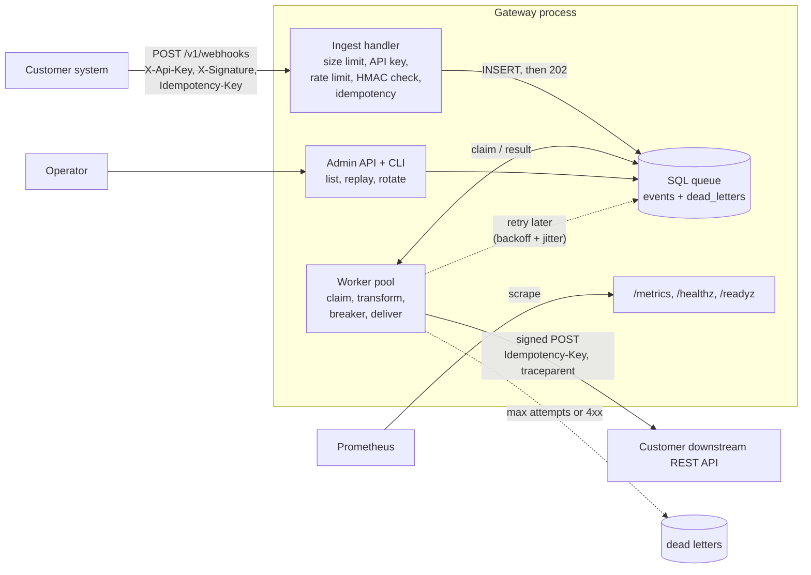

# Webhook and Connector Gateway

A gateway that customer systems send events through. It checks each webhook, saves it, and delivers it to a downstream REST endpoint with retries. It is written in Rust (axum, tokio, sqlx, SQLite).

It answers one question from a customer: "If I send you an event, will it arrive, and how will I know?"

| Feature | How |
|---|---|
| Signed requests | HMAC-SHA256 over `<timestamp>.<body>`, constant-time compare, 5-minute window |
| Replay protection | Timestamp window plus `Idempotency-Key` (same key and body: no second event; same key, other body: 422) |
| Tenants | One API key and one secret each, per-tenant token-bucket rate limit, secret rotation with a grace window |
| Durable queue | Event saved to SQL before the 202. Survives a restart. |
| Workers | Pool of tasks, exponential backoff with jitter, max attempts, dead-letter table, replay |
| Delivery | Per-tenant JSON rules (rename, remove, enrich, keep, drop), timeout, circuit breaker, signed call, trace id passed on |
| Operate | CLI and HTTP admin API: list, inspect, replay, rotate. `/healthz`, `/readyz`, `/metrics` |
| Observe | JSON logs with request ids, Prometheus counters and histograms, queue depth |
| Shutdown | SIGTERM stops new requests and lets workers finish the event they hold |

## Architecture



Request life: the handler does the cheap checks first (size, API key, rate limit, signature). It saves the event with one SQL statement and then sends 202. A worker takes the event with one `UPDATE ... RETURNING`, applies the tenant rules, and calls the downstream. A result of 2xx ends it. A 5xx, timeout, 408, or 429 schedules a retry. Other 4xx, or too many tries, move it to dead letters. If the downstream keeps failing, the circuit opens and events wait without using up attempts.

More: [docs/DECISIONS.md](docs/DECISIONS.md) explains the choices and their cost.

## Quick start

Needs Rust stable (1.85 or newer). On Fedora: `sudo dnf install rust cargo`.

```bash
cargo build --release
cp gateway.example.toml gateway.toml        # edit tenants and rules
GATEWAY_ADMIN_TOKEN=change-me target/release/gateway serve
```

On the first start the gateway makes an API key and a secret for each tenant that has none in the config. It prints them once to the terminal. Copy them then. Only a hash of the API key is stored.

Run the scripted demo (starts everything on random ports): `scripts/demo.sh`
Send your first signed webhook: [docs/ONBOARDING.md](docs/ONBOARDING.md)

## CLI

```text
gateway serve                              run the server and the workers
gateway events [--status S] [--tenant T]   list events
gateway show <id>                          one event with its payload
gateway dead-letters                       list dead letters
gateway replay <id> | --all                put dead events back in the queue
gateway rotate-secret <tenant> [--grace-secs N]
gateway sign --secret S --body-file F      print a signature header
```

`--config` (or `GATEWAY_CONFIG`) selects the config file. Env overrides: `GATEWAY_DATABASE_URL`, `GATEWAY_ADMIN_TOKEN`, `GATEWAY_BIND`.

## HTTP API

| Method and path | Auth | Purpose |
|---|---|---|
| `POST /v1/webhooks` | API key and signature | Send an event. 202 new, 200 duplicate |
| `GET /healthz`, `/readyz`, `/metrics` | none | Liveness, readiness (database), Prometheus |
| `GET /admin/events?status=&tenant=&limit=` | admin bearer token | List |
| `GET /admin/events/{id}` | admin | One event with payload |
| `GET /admin/dead-letters` | admin | Dead letters |
| `POST /admin/events/{id}/replay` | admin | Replay a dead event |
| `POST /admin/tenants/{id}/rotate-secret?grace_secs=` | admin | Rotate, returns the new secret once |

Keep `/admin` and `/metrics` on a private network. The gateway does not end TLS.

## Quality checks (run on the build machine)

```bash
cargo fmt --all -- --check
cargo clippy --all-targets -- -D warnings
cargo test
```

Results at the last run: fmt clean, clippy with `-D warnings` clean, 53 tests passed (37 unit and property tests, 16 integration tests), 0 failed. `cargo audit` and `cargo deny` are not installed on the build machine, so they were not run. CI runs `rustsec/audit-check`. The Docker image and compose file were written but not built, because Docker is not installed on the build machine. No `unsafe` code.

Integration tests start the real router on a random port with a temp SQLite file and a hand-made downstream, and cover: signing, replay window, idempotency, rate limit, size limit, retries, dead letter and replay, permanent 4xx, filtering, circuit breaker, rotation grace, admin auth, metrics, restart with queued events, and graceful shutdown with work in flight. Property tests (proptest) cover signatures (round trip, any body change, wrong secret, window edges, parser never panics) and backoff (bounds, monotonic ceiling, no overflow).

## Performance

About 4,100 to 4,400 accepted events per second with p99 near 25 ms on a 2015 MacBook with the load tool on the same machine, and about 2,200 events/s delivery drain. Details, method, and limits: [docs/PERF.md](docs/PERF.md).

## Docker

```bash
GATEWAY_ADMIN_TOKEN=change-me docker compose up --build
```

Starts the gateway on :8080, a mock downstream on :9000, and Prometheus on :9090. Demo credentials are in `deploy/gateway.compose.toml` (API key `demo-api-key`, secret `demo-secret`). Replace them for anything real.

## Layout

```text
src/            library: signature, backoff, ratelimit, breaker, transform, store,
                worker, delivery, ingest, admin, app, metrics, observability
src/main.rs     CLI and server
src/bin/        mock-downstream, loadtest
tests/          integration tests (in-process server and mock downstream)
docs/           ONBOARDING, RUNBOOK, DEMO, DECISIONS, PERF
LEARN.md        Rust walk-through for a newcomer, interview notes, honest limits
scripts/        demo.sh, perf.sh
deploy/         compose config, Prometheus config
```

## Known limits

SQLite only (Postgres is a design goal, not built). Signing secrets are stored in clear. Rate limit and breaker state are per instance. Delivery is at-least-once with no ordering. Full list in [LEARN.md](LEARN.md).

## License

MIT. Copyright (c) 2026 Stanley Sujith Nelavala.
