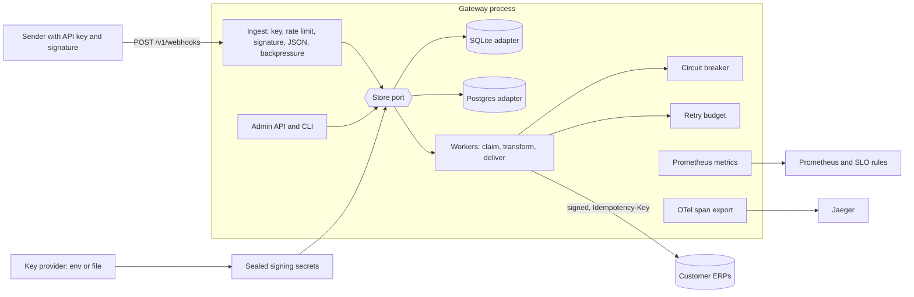

# Architecture

Fictional customer: FieldServiceCo. The gateway takes signed job events and delivers them to customer ERPs.

Trust boundaries: sender to ingest (API key and signature), operator to admin (bearer token), gateway to ERP (outbound signature), gateway to key provider.

| Component | Role |
|---|---|
| Ingest | Checks cheapest first: key, rate limit, signature, JSON, backpressure, then one insert. Answers 202 after commit. |
| Store port | An enum with a SQLite and a Postgres adapter. Claims use `FOR UPDATE SKIP LOCKED` on Postgres. |
| Workers | Claim one event, transform it, sign it, deliver it, and record the result. |
| Circuit breaker | Per tenant. Stops calls to a failing downstream. |
| Retry budget | Per tenant. Caps retries at a share of first attempts. |
| Sealed secrets | Tenant signing secrets are AES-256-GCM sealed. Keys come from a provider. |
| Metrics and SLO | Counters, histograms, and the delivery SLO rules. |
| OTel | Spans `ingest`, `claim`, `deliver` in one trace for each event, when an endpoint is set. |
